# 🏠 Homelab Docker Compose Stack

[](https://www.docker.com/)
[](https://docs.docker.com/compose/)
[](https://kernel.org/)
[](https://www.cloudflare.com/products/tunnel/)
[](https://www.wireguard.com/)

A modular, production-ready collection of Docker Compose stacks powering a self-hosted homelab. Features media streaming, automated acquisition behind a VPN kill-switch, smart home automation, photo backup, password management, remote access via Cloudflare Tunnels, and unified dashboarding.

---

## 📑 Table of Contents

- [Architecture Overview](#-architecture-overview)
- [Stack Breakdown](#-stack-breakdown)
- [Repository Structure](#-repository-structure)
- [Prerequisites](#-prerequisites)
- [Quick Start Guide](#-quick-start-guide)
- [Media Storage & Hardlinks (TRaSH Guides)](#-media-storage--hardlinks-trash-guides)
- [Detailed Service Configuration](#-detailed-service-configuration)
  - [1. Cloudflare Tunnel (`cloudflare`)](#1-cloudflare-tunnel-cloudflare)
  - [2. Media Automation & VPN (`servarr`)](#2-media-automation--vpn-servarr)
  - [3. Streaming & Media (`jellyfin`)](#3-streaming--media-jellyfin)
  - [4. Photo Management (`immich`)](#4-photo-management-immich)
  - [5. Home Automation (`home-assistant`)](#5-home-automation-home-assistant)
  - [6. Password Management (`vaultwarden`)](#6-password-management-vaultwarden)
  - [7. Productivity & Notes (`obsidian`, `kavita`, `webdav`)](#7-productivity--notes-obsidian-kavita-webdav)
  - [8. Dashboard (`homarr`)](#8-dashboard-homarr)
- [Security Best Practices](#-security-best-practices)
- [Maintenance & Useful Commands](#-maintenance--useful-commands)

---

## 🏛 Architecture Overview

```mermaid
flowchart TD
    subgraph Ingress ["Public Ingress & Remote Access"]
        WAN[Internet] --> CFTunnel[Cloudflare Zero Trust Tunnel]
        CFTunnel --> CFNet[cloudflare_tunnelnet Bridge]
    end

    subgraph TunnelServices ["Services Exposed via Cloudflare Tunnel"]
        CFNet --> VW[Vaultwarden<br/>:8888]
        CFNet --> IMM[Immich Server<br/>:2283]
        CFNet --> KAV[Kavita<br/>:5000]
        CFNet --> OBS[Obsidian LiveSync<br/>:5984]
        CFNet --> WD[WebDAV<br/>:80]
    end

    subgraph MediaVPN ["Servarr Network (172.39.0.0/24)"]
        subgraph VPNPod ["Gluetun VPN Pod (WireGuard Killswitch)"]
            GT[Gluetun Client]
            QBT[qBittorrent :8080]
            NZB[NZBGet :6789]
            PROW[Prowlarr :9696]
            FLARE[FlareSolverr :8191]
        end

        GT --- QBT
        GT --- NZB
        GT --- PROW
        GT --- FLARE

        SON[Sonarr :8989<br/>172.39.0.3]
        RAD[Radarr :7878<br/>172.39.0.4]
        LID[Lidarr :8686<br/>172.39.0.5]
        BAZ[Bazarr :6767<br/>172.39.0.6]
        SEERR[Seerr :5055<br/>172.39.0.7]
        CHAP[Chaptarr :8789<br/>172.39.0.11]
        HOM[Homarr Dashboard :7575<br/>172.39.0.10]
    end

    subgraph LocalOnly ["Local Host Network"]
        HA[Home Assistant Core]
        MS[Python Matter Server]
        JF[Jellyfin Media Server<br/>/dev/dri Transcoding]
    end

    subgraph Storage ["Unified Storage (/data)"]
        TORR["/data/torrents (incomplete & seeding)"]
        MEDIA["/data/media (movies, tv, music, books)"]
    end

    QBT --> Storage
    SON --> Storage
    RAD --> Storage
    LID --> Storage
    JF --> MEDIA
```



---

## 📦 Stack Breakdown

| Service | Directory | Port(s) | Network | Description |
|---|---|---|---|---|
| **Cloudflared** | `cloudflare/` | — | `cloudflare_tunnelnet` | Cloudflare Zero Trust tunnel for secure remote access without opening router ports. |
| **Homarr** | `homarr/` | `7575` | `servarrnetwork` | Central dashboard monitoring media, downloads, and homelab services. |
| **Home Assistant** | `home-assistant/` | Host (`8123`) | `host` | Open-source home automation hub for IoT devices. |
| **Matter Server** | `home-assistant/` | Host (`5580`) | `host` | Python Matter controller server for Matter-over-Thread and Wi-Fi devices. |
| **Immich** | `immich/` | `2283` | `cloudflare_tunnelnet` | High-performance self-hosted photo & video backup with ML facial recognition and PostgreSQL/pgvector. |
| **Jellyfin** | `jellyfin/` | `8096`, `7359/udp`, `1900/udp` | Bridge | Hardware-accelerated (`/dev/dri`) media server for 4K/HDR movies and TV shows. |
| **Kavita** | `kavita/` | `5000` | `cloudflare_tunnelnet` | Modern reader and library server for comics, manga, and e-books. |
| **Obsidian LiveSync** | `obsidian/` | `5984` | `cloudflare_tunnelnet` | Self-hosted CouchDB synchronization backend for Obsidian markdown notes. |
| **Gluetun** | `servarr/` | `8080`, `6881`, `6789`, `9696`, `8191` | `servarrnetwork` (`172.39.0.2`) | WireGuard / OpenVPN client acting as the network gateway for downloaders with a strict kill-switch. |
| **qBittorrent** | `servarr/` | Routed via Gluetun | `service:gluetun` | Torrent client strictly bound to the VPN tunnel. |
| **deunhealth** | `servarr/` | — | `none` | Monitors container health and restarts unhealthy services automatically. |
| **NZBGet** | `servarr/` | Routed via Gluetun | `service:gluetun` | Usenet downloader routed through VPN. |
| **Prowlarr** | `servarr/` | Routed via Gluetun | `service:gluetun` | Indexer manager integrating torrent trackers and Usenet indexers with Sonarr/Radarr. |
| **FlareSolverr** | `servarr/` | Routed via Gluetun | `service:gluetun` | Proxy server to solve anti-bot and Cloudflare challenges for indexers. |
| **Sonarr** | `servarr/` | `8989` | `servarrnetwork` (`172.39.0.3`) | TV series management and automated downloader coordinator. |
| **Radarr** | `servarr/` | `7878` | `servarrnetwork` (`172.39.0.4`) | Movie library manager and automated downloader coordinator. |
| **Lidarr** | `servarr/` | `8686` | `servarrnetwork` (`172.39.0.5`) | Music library manager and automated downloader coordinator. |
| **Bazarr** | `servarr/` | `6767` | `servarrnetwork` (`172.39.0.6`) | Automated subtitle downloader for Sonarr and Radarr. |
| **Seerr** | `servarr/` | `5055` | `servarrnetwork` (`172.39.0.7`) | Interactive media discovery and request management frontend for users. |
| **Chaptarr** | `servarr/` | `8789` | `servarrnetwork` (`172.39.0.11`) | Audiobook chapters manager and processor. |
| **Vaultwarden** | `vaultwarden/` | `8888` (maps to `80`) | `cloudflare_tunnelnet` | Lightweight Bitwarden-compatible password manager server in Rust. |
| **WebDAV** | `webdav/` | `80` | `cloudflare_tunnelnet` | Digest-authenticated WebDAV storage server. |

---

## 📂 Repository Structure

```text
.
├── .gitignore
├── README.md
├── cloudflare/
│   ├── .env.example
│   └── compose.yaml
├── homarr/
│   ├── .env.example
│   └── compose.yaml
├── home-assistant/
│   ├── .env.example
│   └── compose.yaml
├── immich/
│   ├── .env.example
│   └── compose.yaml
├── jellyfin/
│   ├── .env.example
│   └── compose.yaml
├── kavita/
│   ├── .env.example
│   └── compose.yaml
├── obsidian/
│   ├── .env.example
│   └── compose.yaml
├── servarr/
│   ├── .env.example
│   └── compose.yaml
├── vaultwarden/
│   ├── .env.example
│   └── compose.yaml
└── webdav/
    ├── .env.example
    └── compose.yaml
```

Each stack is completely decoupled into its own subdirectory. This enables you to start, stop, update, or troubleshoot individual services without touching unrelated workloads.

---

## ⚙️ Prerequisites

1. **Host Operating System**: Linux (Ubuntu 22.04/24.04 LTS, Debian 12, or Proxmox VE LXC/VM).
2. **Docker Engine & Docker Compose**:
   ```bash
   # Install Docker using the official convenience script
   curl -fsSL https://get.docker.com -o get-docker.sh
   sudo sh get-docker.sh
   sudo usermod -aG docker $USER
   newgrp docker
   ```
3. **User & Group IDs**:
   Check your primary user's UID and GID to avoid file permission issues across media containers:
   ```bash
   id $USER
   # Typical output: uid=1000(mason) gid=1000(mason)
   ```
4. **WireGuard VPN Subscription** (Required for Gluetun):
   Supported providers include ProtonVPN, AirVPN, Mullvad, NordVPN, Surfshark, etc. Have your WireGuard private key ready.
5. **Cloudflare Account**:
   Domain onboarded with Cloudflare Zero Trust to run `cloudflared`.

---

## 🚀 Quick Start Guide

### Step 1: Clone the Repository

```bash
git clone https://github.com/your-username/homelab-docker.git ~/docker
cd ~/docker
```

### Step 2: Create Shared Docker Networks

Services exposed to Cloudflare Tunnels and the media stack communicate through dedicated networks. Create them before launching dependent stacks:

```bash
# Network for Cloudflare Tunnel ingress
docker network create cloudflare_tunnelnet

# Network for Servarr stack with fixed subnet (if not launching servarr first)
docker network create --subnet=172.39.0.0/24 servarrnetwork
```

> [!NOTE]
> Launching `cloudflare/compose.yaml` and `servarr/compose.yaml` automatically creates their respective networks if they do not already exist.

### Step 3: Configure Environment Variables

Every directory has a `.env.example` file. Copy each example file to `.env` and fill in your passwords and keys:

```bash
# Example for Servarr stack
cd ~/docker/servarr
cp .env.example .env
nano .env

# Example for Immich
cd ~/docker/immich
cp .env.example .env
nano .env

# Repeat for cloudflare, homarr, jellyfin, etc.
```

### Step 4: Prepare Storage Paths

Ensure your media and photo storage directories exist and have proper ownership:

```bash
sudo mkdir -p /data/media/{movies,tv,music,books}
sudo mkdir -p /data/torrents/{incomplete,complete}
sudo mkdir -p /data/photos

# Give your user ownership
sudo chown -R 1000:1000 /data
```

### Step 5: Start Your Services

Navigate into any stack directory and bring it up in detached mode:

```bash
# Start Cloudflare Tunnel
cd ~/docker/cloudflare && docker compose up -d

# Start Servarr Media Automation
cd ~/docker/servarr && docker compose up -d

# Start Jellyfin
cd ~/docker/jellyfin && docker compose up -d

# Start Immich
cd ~/docker/immich && docker compose up -d
```

---

## 💽 Media Storage & Hardlinks (TRaSH Guides)

This setup adheres to the [TRaSH Guides](https://trash-guides.info/Hardlinks/How-to-setup-for/Docker/) atomic move and hardlink structure.

### Why This Matters

When downloaders (qBittorrent/NZBGet) and media managers (Sonarr/Radarr) share a single unified mount point (`/data`), files can be **instantaneously hardlinked** across folders on the same filesystem.
- **No slow disk copies**: Importing a 50GB 4K Remux takes less than a millisecond.
- **Zero duplicate storage**: Seed torrents from `/data/torrents` while watching them from `/data/media/movies` without taking double the disk space.
- **Less IO wear**: Dramatically reduces write wear on SSDs/HDDs.

### Recommended Directory Hierarchy

```text
/data
├── torrents
│   ├── complete
│   │   ├── movies
│   │   ├── tv
│   │   └── music
│   └── incomplete
└── media
    ├── movies
    ├── tv
    ├── music
    └── books
```

In Sonarr/Radarr:
- Root media folder: `/data/media/tv` or `/data/media/movies`
- Download client remote path: `/data/torrents/complete`

---

## 🔧 Detailed Service Configuration

### 1. Cloudflare Tunnel (`cloudflare`)

Exposes selected internal services to the internet securely via HTTPS without opening any inbound ports on your home firewall or router.

1. Go to [Cloudflare Zero Trust Dashboard](https://one.dash.cloudflare.com/) > **Networks** > **Tunnels**.
2. Create a Cloudflare Tunnel (named e.g. `homelab-tunnel`).
3. Copy the token provided in the Docker command and place it into `cloudflare/.env`:
   ```env
   CLOUDFLARE_TUNNEL_TOKEN=eyJhIjoi...
   ```
4. Under Public Hostnames in the dashboard, route traffic directly to the Docker container names on the `cloudflare_tunnelnet` network:
   - `vaultwarden.yourdomain.com` ➔ `http://vaultwarden:80`
   - `photos.yourdomain.com` ➔ `http://immich_server:2283`
   - `books.yourdomain.com` ➔ `http://kavita:5000`

### 2. Media Automation & VPN (`servarr`)

> [!NOTE]
> The Servarr media stack configuration was adapted and pulled from [TechHutTV/homelab](https://github.com/TechHutTV/homelab) (see the `media` stack).

The `servarr` stack runs all download clients strictly inside a **Gluetun VPN Pod**.
- **DNS Leak Protection & Kill Switch**: If the WireGuard connection drops, internet access is severed immediately.
- **Network Mode `service:gluetun`**: qBittorrent, NZBGet, Prowlarr, and FlareSolverr share Gluetun's network namespace and IP address.
- **Fixed Subnet (`172.39.0.0/24`)**: Sonarr, Radarr, Lidarr, Bazarr, and Seerr are assigned static IPs to simplify inter-container webhooks and API configuration.

#### Verifying VPN Connectivity & IP
```bash
docker exec gluetun wget -qO- https://ipinfo.io/ip
```
Confirm the returned IP belongs to your VPN provider, not your residential ISP.

### 3. Streaming & Media (`jellyfin`)

Jellyfin includes `/dev/dri:/dev/dri` pass-through for Intel QuickSync Video (QSV) or AMD AMF hardware-accelerated transcoding.

Ensure your host user belongs to the `render` and `video` groups:
```bash
sudo usermod -aG render,video $USER
ls -l /dev/dri
```
In Jellyfin Dashboard > **Playback** > **Transcoding**, select **Intel QuickSync (QSV)** or **VA-API**.

### 4. Photo Management (`immich`)

Immich runs with:
- `immich-server`: Web frontend and REST API.
- `immich-machine-learning`: CLIP image search, face recognition, and duplicate detection.
- `redis` (Valkey): High-throughput queue.
- `database` (PostgreSQL with `vectorchord` and `pgvectors`): Vector embeddings for semantic search.

Configure `immich/.env`:
```env
UPLOAD_LOCATION=/data/photos
DB_DATA_LOCATION=./postgres
DB_PASSWORD=choose_a_strong_password
```

### 5. Home Automation (`home-assistant`)

Home Assistant and Python Matter Server run in `network_mode: host`. Host networking is mandatory for:
- mDNS / SSDP local device discovery (e.g., Philips Hue, ESPHome, Google Cast, Sonos).
- Matter-over-Thread and IPv6 link-local discovery packets.

Web UI is accessible at `http://<HOST-IP>:8123`.

### 6. Password Management (`vaultwarden`)

Vaultwarden is configured with signups disabled by default for security:
1. In `vaultwarden/.env`, set `SIGNUPS_ALLOWED=true`.
2. Start the container and register your admin master account.
3. Once registered, switch `SIGNUPS_ALLOWED=false` and run `docker compose up -d` to block unauthorized signups.

### 7. Productivity & Notes (`obsidian`, `kavita`, `webdav`)

- **Obsidian LiveSync (`obsidian`)**: CouchDB instance enabling end-to-end encrypted synchronization across desktop and mobile devices using the Obsidian Self-hosted LiveSync plugin.
- **Kavita (`kavita`)**: Responsive web and OPDS reader for books, manga, and comics.
- **WebDAV (`webdav`)**: Digest-authenticated WebDAV storage for remote file syncing, Joplin, or KeepassXC database sync.

### 8. Dashboard (`homarr`)

Homarr serves as your homelab start page.
- Generate encryption key in `homarr/.env`:
  ```bash
  openssl rand -hex 32
  ```
- Accessible on `http://<HOST-IP>:7575`.
- Integrates with Sonarr, Radarr, qBittorrent, and Jellyfin using their respective API keys.

---

## 🔒 Security Best Practices

1. **Keep Secrets Out of Version Control**:
   - The `.gitignore` is pre-configured to ignore all `.env` files, config folders, databases, and logs.
   - Always commit only `.env.example` templates.
2. **Never Expose Raw Management Ports**:
   - Never expose qBittorrent, Sonarr, or Radarr directly to the public internet. Use Tailscale/WireGuard or Cloudflare Access with Zero Trust Email OTP / SSO authentication.
3. **Run as Non-Root**:
   - Services use `PUID=1000` and `PGID=1000` to drop container permissions to an unprivileged host user.
4. **Regular Database Backups**:
   - Periodically dump the PostgreSQL database for Immich and Vaultwarden SQLite database:
     ```bash
     # Immich DB backup
     docker exec -t immich_postgres pg_dumpall -c -U postgres > immich_backup_$(date +%F).sql
     ```

---

## 🛠 Maintenance & Useful Commands

### Update a Stack to Latest Images
```bash
cd ~/docker/<service>
docker compose pull
docker compose up -d --remove-orphans
```

### Clean Up Dangling Images & Volumes
```bash
docker image prune -f
docker system prune -a --volumes -f
```

### View Live Logs
```bash
docker compose logs -f <service_name>
```

---

## 🙏 Credits & Acknowledgments

- **[TechHutTV/homelab](https://github.com/TechHutTV/homelab)**: The `servarr` compose stack and Gluetun VPN routing configuration were adapted from TechHut's media stack.
- **[TRaSH Guides](https://trash-guides.info/)**: Recommended atomic hardlink folder structures and automation workflows.

---

## 📄 License

This repository is distributed under the [MIT License](LICENSE). Feel free to adapt these compose configurations to suit your homelab!
